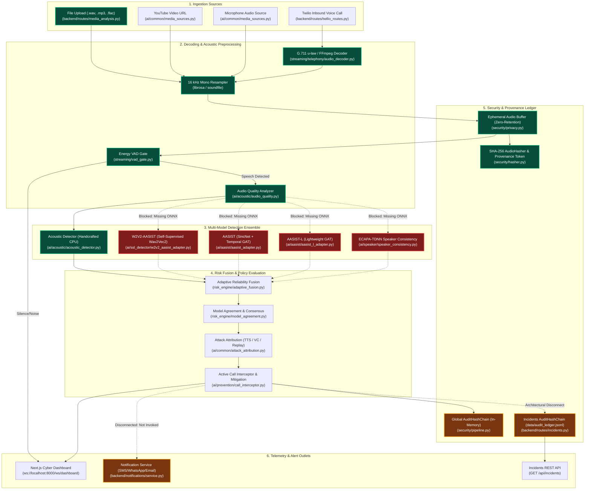
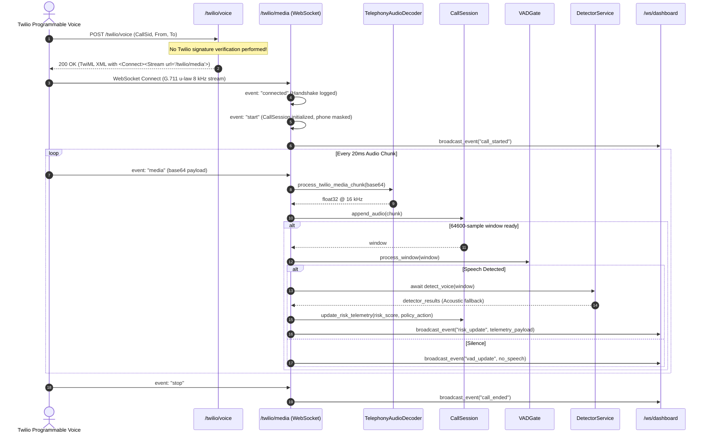

# Dhwani Phase 0: System Architecture Map
**Project:** Dhwani (ध्वनि) / EchoShield AI  
**Target Branch:** `master`  
**Reference Commit:** `a45e40aa6fec462cc770325b41802f8629e4b1f7`  

---

## 1. End-to-End System Architecture



---

## 2. Request Flow Deep Dives

### Flow 1: File Audio Analysis (`POST /api/analyze/upload`)
- **Source Route:** `backend/routes/media_analysis.py` (`analyze_uploaded_file`)
- **Pipeline Class:** `ai/common/common_pipeline.py` (`UnifiedMediaPipeline`)

```mermaid
sequenceDiagram
    autonumber
    actor Client as User / Dashboard
    participant API as FastAPI (/api/analyze/upload)
    participant Pipe as UnifiedMediaPipeline
    participant VAD as Energy VAD Gate
    participant Det as DetectorService
    participant Risk as Risk Engine
    participant WS as WebSocket Broadcaster

    Client->>API: POST /api/analyze/upload (file, multipart/form-data)
    API->>API: Save to ephemeral temp file (Path: tempfile/dhwani_uploads)
    API->>WS: broadcast_event("analysis_started")
    API->>Pipe: analyze_source(FileAudioSource)
    Pipe->>Pipe: Load, resample to 16 kHz mono [-1.0, 1.0]
    Pipe->>Pipe: Compute evidence SHA-256 hash
    Pipe->>VAD: Sliced rolling 64600-sample windows (1s hop)
    alt Window is Voiced Speech
        VAD-->>Pipe: speech_detected = True
        Pipe->>Det: detect_voice_sync(window)
        Note over Det: Tries W2V2, AASIST, AASIST-L, Acoustic, ECAPA.<br/>4 models fail to load; runs Acoustic only.
        Det-->>Pipe: raw_scores, quality diagnostics
        Pipe->>Risk: assess_risk(detector_results, quality)
        Risk-->>Pipe: risk_score, attribution, consensus, policy_action
    else Window is Silence / Noise
        VAD-->>Pipe: speech_detected = False (Skip deep models)
    end
    API->>WS: broadcast_event("analysis_completed", result)
    API->>API: Unlink temporary file (unless DHWANI_RETAIN_AUDIO=true)
    API-->>Client: 200 OK (JSON Canonical AnalysisResult)
```

---

### Flow 2: Live Telephony Streaming (`POST /twilio/voice` & `WSS /twilio/media`)
- **Inbound Webhook:** `backend/routes/twilio_routes.py` (`twilio_inbound_voice_webhook`)
- **WebSocket Consumer:** `streaming/telephony/twilio_websocket.py` (`handle_twilio_media_stream`)
- **Session Manager:** `streaming/telephony/call_session.py` (`CallSession`)



---

## 3. Critical Architectural Disconnects & Fractures

### 3.1 Dual Disconnected Audit Hash Chains
The repository maintains two completely disjoint cryptographic hash chain instances:

1. **Global Provenance Chain:**  
   - Declared in: `security/middleware.py` (`_GLOBAL_PIPELINE`)
   - Queried by: `backend/routes/audit.py` (`/api/audit/verify`, `/trail`, `/latest`, `/certificate`)
   - Written by: `backend/routes/analyze.py`
   - Persistence: **In-Memory only** by default (`persistence_file=None`). All entries disappear on restart.

2. **Incidents Ledger Chain:**  
   - Declared in: `backend/routes/incidents.py` (`audit_chain = AuditHashChain(persistence_file="data/audit_ledger.jsonl")`)
   - Queried by: `backend/routes/incidents.py` (`/api/incidents`, `/api/incidents/verify/chain`)
   - Persistence: Persisted to `data/audit_ledger.jsonl`.
   - In-Memory Incident Store: `INCIDENT_RECORDS: Dict = {}` is **not restored** from `data/audit_ledger.jsonl` upon server restart.

**Consequence:** An event recorded via `/api/analyze` is never visible in `/api/incidents`, and an incident verified via `/api/incidents/verification` does not update the audit certificate in `/api/audit/certificate`.

---

### 3.2 Unconnected Notification Service
- **Implementation:** `backend/notifications/service.py` provides `NotificationService` supporting Twilio SMS, WhatsApp, Email (SMTP), and Console alerts with cooldown deduplication.
- **Reality:** Grep analysis reveals that `dispatch_security_alert` is **only called inside `tests/test_notifications.py`**.
- Neither `backend/routes/analyze.py`, `backend/routes/media_analysis.py`, `backend/routes/incidents.py`, nor `streaming/telephony/twilio_websocket.py` ever instantiates or calls `NotificationService` when a critical deepfake or high-risk session is detected.

---

### 3.3 Module Import Rebinder Bug in System Telemetry
- **File:** `backend/routes/system.py`
- Line 12 imports detectors statically at load time:
  ```python
  from backend.services.detector import _AASIST_MODEL, _AASIST_L_MODEL, _ACOUSTIC_MODEL, _W2V2_MODEL, _SPEAKER_ENGINE
  ```
- Because these variables are `None` when `system.py` is first imported, Python binds local references to `None`.
- When `_init_detectors()` executes later, it rebinds the global variables in `detector.py`, but `system.py`'s local bindings remain `None`.
- **Result:** `GET /api/system/status` always returns `"active_models": []`, even when the Acoustic Detector is loaded and operational.

---

### 3.4 Shared Mutable State in Singleton Detectors
- `ai/speaker/speaker_consistency.py` maintains `self.anchor_embedding` and `self.recent_embeddings` on the `SpeakerConsistencyEngine` instance.
- `backend/services/detector.py` instantiates `_SPEAKER_ENGINE` as a module-level global singleton.
- **Consequence:** In a multi-user or multi-call environment, incoming audio from User B will compare against the enrolled vocal anchor of User A, corrupting speaker consistency evaluation across sessions.
