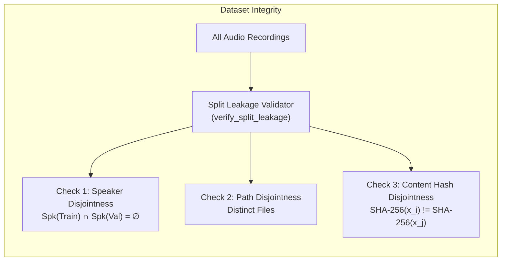

# Phase 4: Scientific Evaluation & Benchmarking Protocol

**Date:** October 25, 2026  
**Repository Branch:** `feature/phase-1-inference-foundation`  
**Base Commit:** `a45e40aa6fec462cc770325b41802f8629e4b1f7`  
**Document Status:** Approved Protocol  

---

## 1. Class Definitions, Score Semantics, and Decision Rules

Scientific anti-spoofing evaluations require unambiguous definition of classes, score directions, and decision rules.

### 1.1 Class Mappings
In Dhwani's evaluation framework:
- **Positive Class ($y = 1$):** `spoof` (Synthesized speech, voice conversion, cloned audio, replay attacks, or adversarial perturbations).
- **Negative Class ($y = 0$):** `bonafide` (Authentic, genuine human speech recorded live).

Heterogeneous dataset labels are canonicalized via `scripts.evaluation.dataset.LabelCanonicalizer`:
- `{"bonafide", "bona-fide", "genuine", "real", "0"} -> 0`
- `{"spoof", "fake", "synthetic", "clone", "attack", "1"} -> 1`
- Ambiguous labels (e.g. `unknown`, `maybe`, `human_or_ai`) raise a strict `ValueError` to prevent data corruption.

### 1.2 Score Semantics
Every detector and the fused pipeline outputs a normalized posterior probability:
$$s \in [0.0, 1.0], \quad s \approx P(\text{spoof} \mid \mathbf{x})$$

- **Directionality:** Higher scores strictly indicate higher likelihood of spoofing/cloning.
- **Decision Rule:** For an operating threshold $\tau \in (0, 1)$:
  $$\hat{y} = \begin{cases} 1 & \text{if } s \ge \tau \ (\text{classified as spoof}) \\ 0 & \text{if } s < \tau \ (\text{classified as bona fide}) \end{cases}$$

---

## 2. Mathematical Metric Formulations

### 2.1 Confusion Matrix Elements
Given ground-truth binary labels $y_i \in \{0, 1\}$ and binary predictions $\hat{y}_i \in \{0, 1\}$:
- **True Positives ($\text{TP}$):** $\sum_{i} \mathbb{I}(y_i = 1 \land \hat{y}_i = 1)$ — Spoofs correctly detected.
- **False Positives ($\text{FP}$):** $\sum_{i} \mathbb{I}(y_i = 0 \land \hat{y}_i = 1)$ — Bona fide audio falsely rejected as spoof.
- **True Negatives ($\text{TN}$):** $\sum_{i} \mathbb{I}(y_i = 0 \land \hat{y}_i = 0)$ — Bona fide audio correctly accepted as genuine.
- **False Negatives ($\text{FN}$):** $\sum_{i} \mathbb{I}(y_i = 1 \land \hat{y}_i = 0)$ — Spoofs missed and falsely accepted as genuine.

### 2.2 Biometric Error Rates (ISO/IEC 19795-1 Standard)
In voice biometrics, system accuracy is characterized by two fundamental rates:
1. **False Alarm Rate ($\text{FAR}$ / $P_{fa}$ / False Rejection of Genuine):**
   $$P_{fa}(\tau) = \frac{\text{FP}}{\text{TN} + \text{FP}} = \frac{\text{FP}}{N_{\text{bonafide}}}$$
   Measures the fraction of authentic users wrongly blocked. In customer telephony, high FAR creates user friction.

2. **Miss Rate ($\text{FRR}$ / $P_{miss}$ / False Acceptance of Spoof):**
   $$P_{miss}(\tau) = \frac{\text{FN}}{\text{TP} + \text{FN}} = \frac{\text{FN}}{N_{\text{spoof}}}$$
   Measures the fraction of deepfake attacks that bypass detection. In banking, high FRR creates severe security breaches.

### 2.3 Equal Error Rate (EER) via Linear Interpolation
The Equal Error Rate is the unique operating point where the false alarm rate equals the miss rate:
$$\text{EER} = P_{fa}(\tau_{EER}) = P_{miss}(\tau_{EER})$$

Because discrete evaluation samples produce step functions, Dhwani calculates EER via continuous linear interpolation across the zero-crossing of $(P_{fa} - P_{miss})$:
1. Sweep candidate thresholds $\tau$ across the continuous spectrum.
2. Identify consecutive operating points $\tau_1, \tau_2$ where:
   $$\Delta_1 = P_{fa}(\tau_1) - P_{miss}(\tau_1) \le 0 \quad \text{and} \quad \Delta_2 = P_{fa}(\tau_2) - P_{miss}(\tau_2) \ge 0$$
3. Interpolate the exact crossing ratio $\alpha$:
   $$\alpha = \frac{P_{miss}(\tau_1) - P_{fa}(\tau_1)}{(P_{fa}(\tau_2) - P_{fa}(\tau_1)) - (P_{miss}(\tau_2) - P_{miss}(\tau_1))}, \quad \alpha \in [0, 1]$$
4. Compute:
   $$\tau_{EER} = \tau_1 + \alpha(\tau_2 - \tau_1), \quad \text{EER} = P_{fa}(\tau_1) + \alpha(P_{fa}(\tau_2) - P_{fa}(\tau_1))$$

### 2.4 Area Under the ROC Curve (ROC-AUC)
The Receiver Operating Characteristic (ROC) curve plots True Positive Rate ($\text{TPR} = 1 - P_{miss}$) against False Positive Rate ($\text{FPR} = P_{fa}$) across all possible thresholds.
Dhwani computes ROC-AUC using exact trapezoidal numerical integration:
$$\text{ROC-AUC} = \int_{0}^{1} \text{TPR}(\text{FPR}) \, d\text{FPR} \approx \sum_{k=1}^{M-1} \frac{\text{TPR}_k + \text{TPR}_{k+1}}{2} (\text{FPR}_{k+1} - \text{FPR}_k)$$
Anchored at $(0, 0)$ and $(1, 1)$.

### 2.5 Inference Latency & Percentiles
For each utterance $i$, elapsed wall-clock inference time is measured:
$$t_i = (t_{\text{end}, i} - t_{\text{start}, i}) \times 1000 \quad \text{[ms]}$$
The pipeline records:
- Arithmetic Mean: $\bar{t} = \frac{1}{N}\sum t_i$
- Median ($p_{50}$): 50th percentile latency
- 95th Percentile ($p_{95}$): Critical for real-time streaming SLO compliance ($\le 500$ ms budget).

---

## 3. Leakage-Safe Partitioning Guarantees

Data leakage between training, validation, and testing partitions invalidates scientific results and causes severe overoptimistic performance reporting. Dhwani enforces strict partitioning protocols:

### 3.1 Speaker-Disjoint Separation
- Models must not be evaluated on speech from speakers seen during training. Neural networks readily memorize speaker timbre rather than anti-spoofing artifacts.
- In ASVspoof 2019 LA:
  $$\mathcal{S}_{\text{train}} \cap \mathcal{S}_{\text{dev}} = \emptyset, \quad \mathcal{S}_{\text{train}} \cap \mathcal{S}_{\text{eval}} = \emptyset, \quad \mathcal{S}_{\text{dev}} \cap \mathcal{S}_{\text{eval}} = \emptyset$$
  - $\mathcal{S}_{\text{train}}$: 20 speakers
  - $\mathcal{S}_{\text{dev}}$: 20 speakers
  - $\mathcal{S}_{\text{eval}}$: 67 speakers

### 3.2 Content-Hash Duplicate Detection
- Files with identical waveforms under different names (common in web-scraped datasets) are detected using SHA-256 content hashing in `scripts.evaluation.dataset.AudioValidator.compute_content_hash`.
- Any cross-split hash collision triggers an immediate `LEAKAGE_DETECTED` failure.

### 3.3 Channel and Resampling Discipline
- All incoming audio is verified and standardized:
  - Channels: Multi-channel/stereo is downmixed to mono via $\bar{x} = \frac{1}{C}\sum_{c=1}^C x_c$.
  - Sample Rate: Resampled to 16,000 Hz using polyphase rational filtering.

---

## 4. Threshold Calibration Protocol & Isolation

### 4.1 Strict Test Set Isolation
- **Rule:** The final evaluation/test partition (`eval`) must **NEVER** be examined, queried, or utilized to choose operating thresholds.
- Threshold selection must be conducted exclusively on the Development/Validation split (`dev`).
- The chosen threshold $\tau^*$ is then locked and applied frozen to the evaluation split.

### 4.2 Calibration Optimization Objectives
`scripts/evaluation/calibrate_thresholds.py` supports three explicit objectives on validation predictions:
1. **Equal Error Rate (`eer`):**
   $$\tau^* = \arg\min_\tau |P_{fa}(\tau) - P_{miss}(\tau)|$$
2. **Constrained False Alarm Rate (`target_far`):**
   $$\tau^* = \min \{ \tau \mid P_{fa}(\tau) \le \text{target\_far} \}$$
3. **Cost-Sensitive Decision Loss (`cost_sensitive`):**
   $$\mathcal{L}(\tau) = C_{miss} \cdot P_{\text{spoof}} \cdot P_{miss}(\tau) + C_{fa} \cdot (1 - P_{\text{spoof}}) \cdot P_{fa}(\tau)$$
   $$\tau^* = \arg\min_\tau \mathcal{L}(\tau)$$

### 4.3 Insufficient Data Fallback (Uncalibrated Rule)
- If the validation sample size $N < 100$ or if real labeled validation data is unavailable:
  - The production threshold is **NOT** mutated.
  - The threshold remains at the default **`0.5000`**.
  - The artifact status is formally set to **`UNCALIBRATED`**.
  - High-variance thresholds derived from small synthetic smoke tests are explicitly quarantined.

---

## 5. Missing Model & Detector Reporting Rules

When running evaluations on heterogeneous deployment environments:
1. **Explicit Status Reporting:** If a model checkpoint or ONNX asset is missing (e.g., `w2v2-aasist.onnx`), the model is recorded as:
   $$\text{status} = \text{"SKIPPED"}, \quad \text{raw\_score} = \text{None}$$
2. **Zero Imputation Prohibited:** Missing scores must **never** be imputed as 0.0 (which would falsely label an utterance as bona fide) or 0.5.
3. **Dynamic Weight Normalization:** The ensemble fusion engine normalizes weights exclusively across models that executed successfully:
   $$w_i' = \frac{w_i}{\sum_{j \in \mathcal{M}_{\text{active}}} w_j}$$
4. **Honest Metric Reporting:** If all neural models are unavailable, the ensemble metrics must reflect only operational detectors, and missing models must be highlighted in the evaluation report header.
