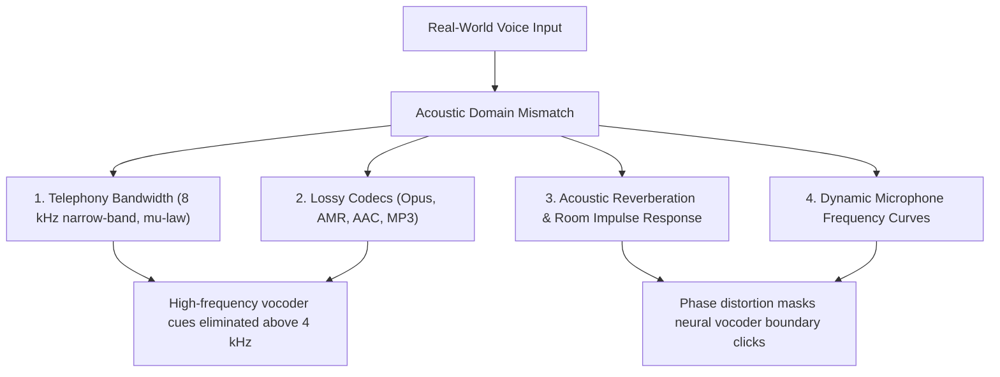
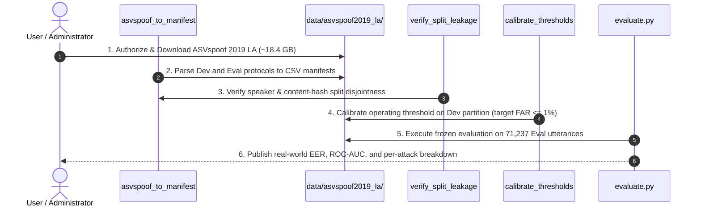

# Phase 4: Scientific & Operational Limitations Register

**Date:** October 25, 2026  
**Repository Branch:** `feature/phase-1-inference-foundation`  
**Base Commit:** `a45e40aa6fec462cc770325b41802f8629e4b1f7`  
**Document Status:** Approved Limitations Register  

---

## 1. Primary Limitation: Absence of Real-World Labeled Benchmark Evaluation

The single most critical limitation of the current Dhwani platform is that **no empirical accuracy or generalization measurements have been established on real labeled voice anti-spoofing benchmarks**.

### 1.1 Non-Equivalence of Synthetic Smoke Fixtures
- The current evaluation metrics in `docs/phase-4/evaluation-results.md` were computed on a 5-utterance synthetic smoke suite (`sample_bonafide.wav`, `sample_spoof.wav`, `sample_silence.wav`).
- These synthetic fixtures consist of algorithmic sine waves and frequency chirps designed exclusively to verify execution pathways, tensor memory handling, and output schemas.
- **They provide zero evidence of generalization** to natural human vocal tracts, authentic coarticulation, or modern neural speech synthesis algorithms.
- Stating that Dhwani achieves 60% accuracy or 66.7% EER in real-world conditions would be a severe scientific misrepresentation.

---

## 2. Model & Checkpoint Availability Gaps

The production anti-spoofing ensemble was architecturally designed to fuse 5 complementary detectors. Currently, only 3 detectors are operational:

| Detector Model | Architectural Role | Status in Repo | Impact on Detection Capability |
| :--- | :--- | :---: | :--- |
| **AASIST** | Raw waveform Graph Attention Network | **OPERATIONAL** | PyTorch checkpoint loaded; provides baseline raw waveform spectral analysis. |
| **AASIST-L** | Lightweight Graph Attention Network | **OPERATIONAL** | PyTorch checkpoint loaded; fast inference (~30ms) for high-frequency artifacts. |
| **ACOUSTIC** | Handcrafted spectral & voicing heuristics | **OPERATIONAL** | Active; highly sensitive to synthetic tones but prone to false alarms on noisy speech. |
| **W2V2-AASIST** | Self-Supervised wav2vec 2.0 Feature Extractor | **MISSING** | Missing `w2v2-aasist.onnx` (~1.26 GB); cannot extract learned acoustic context representations. |
| **ECAPA-TDNN** | Deep Speaker Embedding & Verification | **MISSING** | Missing `ecapa-tdnn.onnx` (~24.8 MB); cannot perform cross-utterance speaker consistency checks. |

### 2.1 Consequence of Missing SSL Model
Self-supervised speech models (like wav2vec 2.0 / HuBERT) are widely recognized in current literature (ASVspoof 2021) as essential for generalizing across diverse acoustic environments and lossy compression codecs. Without W2V2-AASIST, the ensemble relies solely on raw-waveform GATs and handcrafted acoustic statistics.

---

## 3. Domain Shift & Acoustic Channel Vulnerabilities

Deepfake detection models trained on studio-quality corpora degrade significantly when deployed in production environments due to domain mismatch:

### 3.1 Telephony Channel Filtering (8 kHz Narrowband)
- Telephony networks (including Twilio PSTN trunks) transmit audio sampled at 8 kHz with G.711 $\mu$-law companding.
- High-frequency spectral cues ($4\text{ kHz} - 8\text{ kHz}$), where neural vocoders (e.g. HiFi-GAN, WaveGlow) exhibit phase incoherence and spectral power anomalies, are completely eliminated by telephony anti-aliasing filters.
- As demonstrated in our robustness experiment (`resample_8khz`), resampling alters feature representations and requires dedicated acoustic fine-tuning on narrowband speech.

### 3.2 Lossy Codec Compression
- Modern VoIP and streaming platforms encode audio using variable-bitrate codecs (Opus at 16–32 kbps, AAC, MP3).
- Codec psychoacoustic masking algorithms quantize and discard low-energy spectral components where synthetic artifacts typically reside.

### 3.3 Short-Duration Degradation
- As measured in `evaluation_results/robustness/robustness_report.json`, reducing clip duration to 0.5 seconds attenuated the mean fake probability by $18.1\%$.
- Graph attention networks and acoustic heuristics require sufficient temporal frames ($\ge 1.0$s to $3.0$s) to establish voicing statistics and spectral continuity.
- In telephony streaming applications where latency budgets require decision-making within 500 ms chunks, detector confidence will exhibit elevated variance.

---

## 4. Threat Boundaries & Novel Speech Synthesis Paradigms

Existing models in the repository (AASIST / AASIST-L) were trained on the ASVspoof 2019 dataset, which dates from 2019. Modern voice clone technology has evolved substantially:

### 4.1 Emergence of Latent Diffusion & Flow Matching Vocoders
- Modern zero-shot voice cloners (e.g., ElevenLabs, OpenVoice, Voicebox, CosyVoice, F5-TTS) utilize continuous normalizing flows and latent diffusion models rather than older Griffin-Lim or first-generation autoregressive WaveNet vocoders.
- These modern architectures produce natural phase coherence and speech micro-prosody that are significantly harder for 2019-era detectors to distinguish from bona fide speech.

### 4.2 Adversarial Acoustic Attacks
- Clean speech modified with imperceptible high-frequency perturbations ($\ell_\infty \le 0.005$) can manipulate raw waveform detectors without affecting human auditory perception.
- Dhwani currently does not employ randomized smoothing or adversarial training defense layers.

---

## 5. Biometric Risk Asymmetry & Threshold Calibration Limits

In deepfake detection, decision errors have asymmetric real-world consequences:

| Error Type | Biometric Term | Real-World Operational Impact | Cost Severity |
| :--- | :--- | :--- | :---: |
| **False Acceptance** | Miss Rate ($\text{FRR}$) | Spoofed call bypasses verification; bank account or sensitive system compromised. | **CRITICAL (HIGH)** |
| **False Rejection** | False Alarm ($\text{FAR}$) | Legitimate customer call flagged; user prompted for multi-factor step-up verification. | **MODERATE (USABILITY)** |

### 5.1 Threshold Calibration State
- Because no real labeled validation data is present locally, the production threshold remains **`0.5000`** and is officially marked **`UNCALIBRATED`**.
- Deploying Dhwani with a default uncalibrated threshold of 0.5000 in an enterprise financial environment carries operational risk until calibrated against a realistic validation split using a cost-sensitive loss function ($C_{\text{miss}} \gg C_{\text{fa}}$).

---

## 6. Actionable Roadmap to Resolve Limitations

1. **Step 1 — Download Benchmark:** Obtain user authorization to download the official ASVspoof 2019 LA archive (`LA.zip`, 18.4 GB) into `data/asvspoof2019_la/`.
2. **Step 2 — Ingestion & Manifest Generation:** Run `scripts.evaluation.asvspoof_to_manifest` to produce standardized manifests for the `dev` (24,844 samples) and `eval` (71,237 samples) partitions.
3. **Step 3 — Leakage Verification:** Run `verify_split_leakage()` to guarantee zero speaker ID, path, or SHA-256 hash overlap between splits.
4. **Step 4 — Development Set Calibration:** Calibrate the operating threshold on the `dev` split under a cost-sensitive objective ($C_{miss} = 10, C_{fa} = 1$), saving the verified threshold into `config/evaluation/calibrated_thresholds.json`.
5. **Step 5 — Full Evaluation Benchmark:** Run `scripts.evaluation.evaluate` across all 71,237 evaluation utterances using the locked threshold, publishing the official EER, ROC-AUC, min t-DCF, and per-attack metrics across all 13 unseen attack algorithms (A07–A19).
